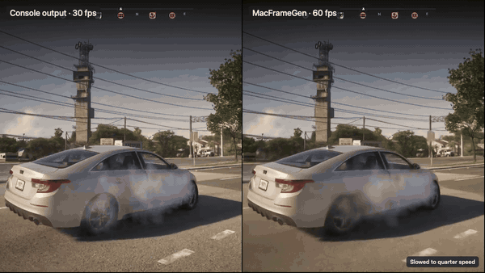

# MacFrameGen

**GTA 6 at 60 fps on a Mac, from a 30 fps console, with a $25 capture card.**

[](docs/demo.mp4)

*Left: what the console sends. Right: the same footage with a generated frame between each pair. Slowed down so
the difference survives a GIF; [the video](docs/demo.mp4) is sharper. The right side was made from a recording
with the offline tool in [Research](Research), which uses the same interpolator as the app. It is not a screen
capture of the app running live.*

GTA 6 runs at 30 fps on console. On Windows there is a growing pile of tools that use NVIDIA and AMD hardware to
smooth it out. If you own a MacBook Pro you have had nothing, even though the Mac already ships with everything
needed: Apple's own low-latency frame interpolator and the MetalFX upscaler.

MacFrameGen is frame generation for the Mac, 30 fps to 60 fps, for a console plugged into a capture card.
It puts those two pieces together. Plug your console into a USB capture card, plug the card into your Mac, and the
app shows the game with a generated frame between every pair of real ones: 30 fps in, 60 fps on screen.

- No extra GPU, no drivers, no kernel extensions. Apple frameworks only.
- Works with any 30 fps console game, not only GTA 6. That is just the one it was built for.
- Light: under one CPU core on the Mac it was measured on.

> Not affiliated with Rockstar Games, Apple, Microsoft or Sony. This is a hobby project.

## What it does, measured

Everything below was measured on one setup: a MacBook Pro (M5 Pro), macOS 27, an Xbox Series S running GTA 6, and
a $25 USB 3 capture card sending uncompressed 1080p at 60 Hz. Nothing here is a claim about other hardware.

| | Measured |
|---|---|
| Frames reaching the screen | 59.7 to 59.9 a second, from 30 real ones |
| Evenness of those frames | spacing varies by 1.5 to 2 ms around the ideal 16.7 ms |
| Time to generate one frame | 9 ms |
| Time to upscale a pair of frames to the MacBook's screen | 3 to 5 ms |
| Delay added by frame generation | about 30 ms, compared with showing the card's picture directly |
| System load | 70 to 79% of one CPU core, 383 MB of memory; the Mac's GPU was about 30% busy overall |

The frame counts and spacing were measured by recording the app's own window as the display shows it, not by
counting what the app believes it sent. Method and raw figures are in [docs/MEASUREMENTS.md](docs/MEASUREMENTS.md).

**The trade-off is input delay.** Interpolation has to hold each real frame back until the frame before it has
been shown. That costs about 30 ms on top of the capture card's own delay, and you can feel it. In a slow-paced
30 fps game the smoothness is worth far more than the delay costs; in anything twitchy it will not be. Full
button-to-screen delay has not been measured yet.

## What you need

- A Mac with Apple silicon running **macOS 26 or later**. Apple's frame interpolator does not exist before that.
- A **USB capture card** that offers **1080p at 60 fps, uncompressed**. Many cheap USB 3 cards do. Cards that
  only offer 60 fps as compressed video (MJPEG) will work but add delay.
- An HDMI cable from the console to the card.
- Xcode's command-line tools, to build the app: `xcode-select --install`.

This was built for one setup and has only been run on that setup. See [What has been tested](#what-has-been-tested).

## Set up

1. **Console:** set video output to 1080p at 60 Hz. On a PlayStation, also turn off HDCP in the HDMI settings,
   or the card will show a black picture. (PlayStation is untested here.)
2. **Cables:** console HDMI out → capture card HDMI in → card's USB plug into the Mac. Use a USB 3 port or hub.
3. **Build and install:**

   ```bash
   git clone https://github.com/KyleCurtisBiz/MacFrameGen && cd MacFrameGen
   scripts/build-app.sh --install
   ```

4. Open **MacFrameGen** from Applications. Allow Camera (that is how macOS classes a capture card) and
   Microphone (the card's sound) when asked. The picture starts by itself.
5. Press **F** for full screen.

To play on an external monitor, connect the monitor to the Mac and move the window there. The capture card does
not need an HDMI pass-through port.

If macOS asks for the permissions again after every rebuild, see the signing note at the top of
[scripts/build-app.sh](scripts/build-app.sh).

## Controls

Plain keys while the window is in front. The same items are in the **Controls** menu.

| Key | What it does |
|---|---|
| **G** | Frame generation on or off. The quickest way to see the difference. |
| **U** | Upscaler on or off. It only does anything when the window is bigger than the picture. |
| **A** | Sound on or off. |
| **S** | Show or hide the frame rate. |
| **F** | Full screen. |

Pick a different capture device in the **Source** menu. Settings are remembered.

### The corner display

A small counter in the top-left reads `30 → 60 fps`: the frames the console is sending each second, then the
frames reaching the display. With frame generation off it is a single number. Press **S** to hide it.

### Advanced menu

Nothing here is needed to play. It is for diagnosing problems and for experiments.

- **Fast Generation:** on by default. Keeps one CPU core busy so a frame takes 9 ms to generate, not 16.
  Turning it off saves power and adds about 9 ms of delay. (The code and docs call this "turbo".)
- **Even Frame Pacing:** on by default. Off shows each generated frame the moment it is ready, which is a few
  milliseconds quicker and visibly less smooth.
- **Show Detailed Numbers:** a line of everything the app measures, the same line it writes once a second to
  `~/Library/Logs/MacFrameGen/macframegen.log`:

  ```
  1920x1080  real 30  gen 30  shown 60 fps  spacing +/-0.0 ms  gaps>25ms 0  late 0  arrive 19 ms  gen 9 ms  upscale 4.1 ms  delay 49 ms  even  FG on  turbo
  ```

  - **real / gen / shown:** real frames accepted, frames generated, frames handed to the display, per second.
  - **spacing, gaps>25ms:** how evenly frames were handed over. Good is near 0 and 0.
  - **late:** generated frames that were not ready for their slot.
  - **arrive:** how long after its timestamp a frame reaches the Mac. This is the capture card, not the app.
  - **delay:** the card's timestamp to the moment a real frame is handed to the display.
- **Measure What Reaches the Screen:** records the app's own window for 10 seconds and reports how many
  distinct frames the display really showed. Needs the Screen Recording permission.

## How it works

1. **Capture.** The card delivers 60 frames a second. A 30 fps game means every frame arrives twice.
2. **Drop the repeats.** Each frame is compared with the last real one; look-alikes are skipped. The cut-off is
   learned from the footage as it plays.
3. **Generate.** Apple's `VTLowLatencyFrameInterpolation` makes the frame halfway between the last two real ones.
4. **Upscale.** MetalFX scales both frames to the window's real pixel size.
5. **Pace.** The generated frame and then the real frame are handed to the display half a frame interval apart,
   on a fixed delay after capture, so motion is even no matter how long generation took.

More detail, including the non-obvious parts, is in [docs/HOW_IT_WORKS.md](docs/HOW_IT_WORKS.md).

## What has been tested

This is one person's project, built for one setup. It is not trying to support every combination; anything not
listed as tested may work, and nobody has tried.

| | Tested | Not tested |
|---|---|---|
| **Mac** | MacBook Pro with M5 Pro, macOS 27 | Any other Mac. Slower chips may not generate a frame in time. Intel Macs and macOS 25 or earlier cannot run it. |
| **Console and game** | Xbox Series S, GTA 6 at 30 fps | PlayStation, Switch, other consoles. Games at 60 fps or 40 fps. |
| **Capture card** | One $25 USB 3 card (USB ID 345f:2131), 1080p 60 Hz uncompressed, with sound | Every other card: compressed-only, 30 fps, 4K, or with sound the app cannot find. |
| **Picture** | 1080p, standard dynamic range | HDR output from the console (expect washed-out colour). 4K output. |
| **Display** | The MacBook's own 120 Hz screen, and one external 1080p monitor | Ultrawide screens, several monitors at once. |

Some of the untested cases have been run through the app's built-in simulated source (`--selftest`, a moving
test pattern, no console or card involved). That checks the app copes; it says nothing about how a real game looks.

| Simulated source | Result |
|---|---|
| 30 fps game in a 60 Hz stream, 1080p | 30 → 60, generation 9 ms |
| 60 fps game | Passed straight through, nothing generated, 12 ms delay |
| 40 fps game | 40 → 60, but every generated frame missed its slot. Expect uneven motion. |
| 20 fps game | 20 → 40 |
| 720p stream | 30 → 60, generation 3 ms |
| A width the interpolator refuses (1900x1080) | Cropped to 1884 wide and ran normally |
| Restarting the pipeline twice a second for 30 s | No crash |
| Thread Sanitizer, with and without the restarts | No data races reported |

### Known rough edges

- **Sound is not delayed to match the picture.** Frame generation holds the picture back about 30 ms and the
  sound plays straight through, so sound is slightly ahead.
- **A black picture** usually means the console is sending copy-protected video. The app says so after a few
  seconds; the fix is in the console's settings (HDCP off on a PlayStation).
- **Text and the minimap can smear** for a frame during fast motion. The interpolator treats the HUD like any
  other part of the picture.

## Limits

- **Added input delay,** about 30 ms. See above.
- **1080p in.** Apple's interpolator refuses anything larger than 1920x1080. The upscaler takes it from there.
- **2x only.** Generating three frames per pair for 120 fps took 37 ms at 1080p, longer than a frame.
- **It is interpolation.** Fast, erratic motion and on-screen text (the HUD, the minimap) can smear briefly.
- **Apple silicon and macOS 26+ only.**

## Things that were tried and dropped

Written up in [docs/FINDINGS.md](docs/FINDINGS.md), with numbers:

- **Predicting frames instead of interpolating,** to remove the hold-back delay. Predicted frames scored no
  better than repeating the last frame.
- **Capturing Xbox Remote Play in a browser** instead of using a card. It worked, but streaming lag and
  resolution made it not worth using.
- **Apple's machine-learning upscaler.** Cleaner picture, 0.3 seconds a frame.
- **4x generation, the card's other pixel format, and several ways of speeding up the interpolator** that did
  nothing.

## Help wanted

The most useful thing you can do is run it on hardware that is not mine and report what happens.

- **Other Macs:** run `MacFrameGen --selftest` (the binary is inside the app at `Contents/MacOS/`) and post the
  output with your Mac model. It needs no capture card and takes 6 seconds.
- **Other capture cards:** post the output of `MacFrameGen --list-devices` and whether the picture and sound work.
- **A real latency number:** film the controller and the screen at 240 fps and count frames from button to reaction.
- **Ideas with code:** protecting the HUD from smearing, handling scene cuts, a faster in-between frame.

## Building for development

```bash
swift build -c release                 # the binary
scripts/build-app.sh                   # the .app bundle in build/
.build/release/MacFrameGen --help     # command-line options
Research/build.sh                      # the offline experiments
```

The app is a Swift package with no dependencies. Sources are in [Sources/MacFrameGen](Sources/MacFrameGen).

## License

MIT. See [LICENSE](LICENSE).
